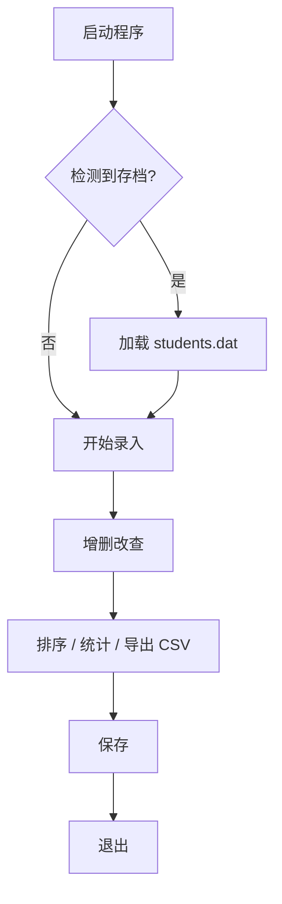

# 学生成绩管理系统 / Student Grade Management System

[](https://en.wikipedia.org/wiki/C11_(C_standard_revision))
[](#编译)
[](LICENSE)
[](#运行测试)

一个轻量级的 C11 控制台程序。没有 GUI，没有数据库，没有外部依赖——编译完直接跑，成绩自动存文件，下次打开接着用。

---

## 目录 / Table of Contents

- [项目介绍](#项目介绍)
- [特性一览](#特性一览)
- [依赖说明](#依赖说明)
- [项目结构](#项目结构)
- [快速开始](#快速开始)
- [使用说明](#使用说明)
- [数据文件](#数据文件)
- [测试](#测试)
- [贡献指南](#贡献指南)
- [联系作者](#联系作者)

---

## 项目介绍

一个老师/助教就能上手的成绩管理小工具。支持录入、查询、修改、删除学生记录，按各科成绩排序排名，生成统计报告，还能一键导出 CSV 给 Excel 打开。

### 工作流程



### 版本历史

- **v2.0** — 模块化重构（5 个 `.c` + 1 个 `.h`）、修复排序后排名不更新的 bug、动态数组扩容（不再限 100 人）、新增单科排序 / 成绩等级 / CSV 导出 / 柱状图可视化 / 科目管理
- **v1.0** — 单文件 767 行，基础的增删改查 + 排序 + 统计 + 文件存取

---

## 特性一览

| 功能 | 说明 |
|------|------|
| 录入 / 修改 / 删除 | 学号唯一校验，修改时空回车跳过 |
| 按学号查询 | 精确匹配 |
| 按姓名查询 | `strstr` 模糊匹配 |
| 排序 | 总分 / 平均分 / 学号 / 任意一科，并列同排名 |
| 统计 | 各科均值 / 最高 / 最低 / 及格率 + 总分汇总 + 等级分布 |
| 可视化 | ASCII 柱状图展示排名前 10 的总分 |
| 成绩等级 | 自动评为 优秀 / 良好 / 中等 / 及格 / 不及格 |
| 持久化 | 二进制 `students.dat`，连科目配置一起存 |
| CSV 导出 | UTF-8 + BOM，Excel / WPS 直接打开 |
| 科目管理 | 默认 3 科（语数英），可自由增删改名，上限 10 科 |

### 成绩等级规则

| 平均分 | 等级 |
|--------|------|
| ≥ 90   | 优秀 |
| ≥ 80   | 良好 |
| ≥ 70   | 中等 |
| ≥ 60   | 及格 |
| < 60   | 不及格 |

---

## 依赖说明

**编译**：任何 C11 兼容编译器（GCC ≥ 4.8、Clang ≥ 3.0、MSVC ≥ 2015）
**测试**：Python ≥ 3.7（仅用标准库 `subprocess`）
**运行**：零外部依赖，纯标准 C

---

## 项目结构

```
student_grade_management_system/
│
├── main.c           # 入口 + 主循环：初始化、菜单分发、退出清理
├── student.h        # 共用头文件：Student / GradeSystem 结构体、常量、函数声明
├── student.c        # 核心业务：增删改查、qsort 比较器、排序排名、成绩等级
├── file_io.c        # 文件层：二进制存档读写 + CSV 导出
├── ui.c             # 交互层：菜单、表格、ASCII 柱状图、输入工具函数
├── commands.c       # 命令实现：每个菜单项对应的具体逻辑
│
├── test_student.py  # 自动化测试：21 个 case 全通过
├── student.exe      # 编译产物（Windows）
│
├── README.md
└── LICENSE          # MIT
```

### 分层关系

```
main.c  ──调用──▶  commands.c
                      │
                      ├──▶  student.c    （核心逻辑，纯计算）
                      ├──▶  file_io.c    （文件存取）
                      └──▶  ui.c         （控制台交互）
                      │
                      ▼
                 student.h  （所有人都 include 它）
```

---

## 快速开始

### Windows（GCC / MinGW）

```bash
# 编译
gcc -std=c11 -Wall -Wextra -o student.exe main.c student.c file_io.c ui.c commands.c

# 运行
./student.exe
```

### Windows（MSVC / Visual Studio）

```cmd
cl /std:c11 /W4 main.c student.c file_io.c ui.c commands.c /Fe:student.exe
student.exe
```

### Linux / macOS

```bash
gcc -std=c11 -Wall -Wextra -o student main.c student.c file_io.c ui.c commands.c
./student
```

### 一行编译 + 测试

```bash
gcc -std=c11 -Wall -Wextra -o student main.c student.c file_io.c ui.c commands.c && python test_student.py
```

---

## 使用说明

### 主菜单

```
==========================================================
           学生成绩管理系统   （共 0 人，3 科）
==========================================================
  1.  录入学生          2.  显示全部
  3.  按学号查询        4.  按姓名模糊查询
  5.  修改信息          6.  删除学生
  7.  排序              8.  统计分析
  9.  保存到文件       10.  从文件读取
 11.  导出 CSV          12.  排名柱状图
 13.  管理科目数         0.  退出
==========================================================
请选择:
```

### 输入规则

- **学号**：正整数，不允许重复
- **分数**：自动 clamp 到 0–100，负数按 0 算，超过 100 按 100 算
- **修改**：字段前直接按回车 = 不改
- **退出**：内存里有未保存数据会问一次要不要存

### 典型会话流程

```
1. 首次运行 → 直接开始录入
2. 后续运行 → 先选 10 加载存档，再录入/修改
3. 改完数据 → 选 9 保存，或退出时自动提示
4. 要 Excel 看 → 选 11 导出 CSV，双击即可打开
```

---

## 数据文件

### `students.dat`（二进制）

```
文件头:  [int count]        学生人数
        [int subject_count] 科目数
科目名:  [char[16] × subject_count]  每项 15 字 + '\0'
学生数据: [Student × count]  裸内存 fwrite
```

- **不可跨平台传递**：Student 结构体直接 fwrite，布局和字节序绑定编译器。同机器同版本没问题，换平台请用 CSV 导出。
- **旧版本兼容**：v2.0 引入了 `subject_count` 字段，v1.0 生成的 `.dat` 加载时科目数会重置为 3。

### `students.csv`

- UTF-8 with BOM（第一字节 `0xEF 0xBB 0xBF`）
- 列：`学号, 姓名, 语文, 数学, 英语, ..., 总分, 平均分, 等级, 名次`
- Excel / WPS 直接双击打开

---

## 测试

```bash
python test_student.py
```

输出：
```
=======================================================
学生成绩管理系统 —— 自动化测试
=======================================================
...（省略各 case 输出）...
=======================================================
测试结果：21 通过，0 失败
=======================================================
```

### 覆盖场景

| # | 场景 |
|---|------|
| 1 | 录入多学生 + 显示全部 |
| 2 | 重复学号被拒绝 |
| 3 | 按学号 / 按姓名查询 |
| 4 | 修改信息 |
| 5 | 四种排序方式（含"按平均分排序后 rank 未更新"的 bug 回归） |
| 6 | 统计分析输出 |
| 7 | 存档写入 + 跨进程加载 |
| 8 | CSV 导出（BOM / 表头 / 等级列） |
| 9 | 成绩等级边界（优秀 / 不及格） |
| 10 | ASCII 柱状图 |

---

## 贡献指南

欢迎提 Issue / 发 PR。

### 开发约定

- **C 标准**：C11，不用 C99 之前的特性
- **编译器警告**：提交前用 `gcc -std=c11 -Wall -Wextra` 编译，零 error
- **文件格式**：UTF-8 无 BOM，换行符 LF
- **注释**：中文，结尾加句号；行内注释用 `/* */`，函数注释用简短的块注释
- **函数命名**：`模块_动词`，如 `sys_find_by_id`、`cmd_add`、`ui_input_int`
- **常量命名**：大写 `V_` 前缀，如 `V_PASS_LINE`
- **运行测试**：`python test_student.py` 全部通过

### 提 PR 的步骤

1. Fork 本仓库
2. 新建分支：`git checkout -b feature/your-feature-name`
3. 改动代码
4. 跑测试：`python test_student.py`
5. 提交：`git commit -m "feat: 你的改动说明"`
6. Push：`git push origin feature/your-feature-name`
7. 发 PR，描述清楚改了什么、为什么改

---

## 联系作者

谙弆悕博士（Ailan Anjuxi）

- 📫 anjuxi.ME@outlook.com
- 📞 sip:anjuxi@sip.linphone.org
- 🔗 https://github.com/anjuxi/student_grade_management_system

---

## License

MIT License. 见 [LICENSE](LICENSE) 文件。
